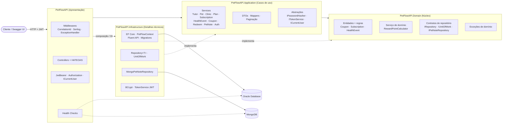

# 🐾 PetFlow API — Sprint 4

**C# · .NET 8 · ASP.NET Core · Clean Architecture · Oracle + EF Core · MongoDB · JWT · HATEOAS · Serilog · OpenTelemetry · xUnit**

> FIAP · Challenge 2026 · *Advanced Business Development with .NET* · Turma **2TDSPX**

---

## 📋 Sumário

1. [Visão geral](#-visão-geral)
2. [Equipe](#-equipe)
3. [Arquitetura](#-arquitetura)
4. [Atendimento aos requisitos da Sprint 4](#-atendimento-aos-requisitos-da-sprint-4)
5. [Regras de negócio](#-regras-de-negócio)
6. [Autenticação e autorização](#-autenticação-e-autorização)
7. [API REST — endpoints](#-api-rest--endpoints)
8. [Persistência: Oracle e MongoDB](#-persistência-oracle-e-mongodb)
9. [Monitoramento e observabilidade](#-monitoramento-e-observabilidade)
10. [Instalação e execução](#-instalação-e-execução)
11. [Testes](#-testes)
12. [Documentação OpenAPI exportada](#-documentação-openapi-exportada)
13. [O que mudou desde a Sprint 3](#-o-que-mudou-desde-a-sprint-3)
14. [Estrutura de pastas](#-estrutura-de-pastas)

---

## 📌 Visão geral

O **PetFlow** é uma API REST para **gerenciamento de saúde preventiva de pets com gamificação**: quando um tutor conclui um evento de saúde do seu pet (vacina, consulta, exame…), ele acumula pontos que podem ser trocados por cupons de desconto em clínicas parceiras.

A Sprint 4 consolida as Sprints 1–3 em um projeto completo:

| Pilar | Entrega |
|-------|---------|
| Arquitetura | Clean Architecture em 4 projetos (Domain, Application, Infrastructure, API), SOLID, DI, tratamento global de exceções (RFC 7807) |
| API REST | Swagger/OpenAPI com JWT, paginação + ordenação + filtros, **HATEOAS**, autenticação e autorização por perfil |
| Persistência | **Oracle** via EF Core (migrations + padrão Repository) e **MongoDB** para anotações clínicas |
| Qualidade | Health checks (Oracle, MongoDB, serviços externos), logging estruturado JSON, métricas/traces, **232 testes automatizados** (AAA, xUnit) |

---

## 👥 Equipe

| Nome | RM |
|------|----|
| Lucas Grillo Alcântara | 561413 |
| Pietro Ferreira Gomes Abrahamian | 561469 |
| Pedro Peres Benitez | 561792 |
| Lucca Ramos Mussumecci | 562027 |

**Turma:** 2TDSPX

---

## 🧱 Arquitetura

### Diagrama de arquitetura



### Regra de dependência

```
PetFlowAPI (API) ──► PetFlowAPI.Application ──► PetFlowAPI.Domain
       │                                              ▲
       └────────► PetFlowAPI.Infrastructure ──────────┘   (Infrastructure → Application → Domain)
```

* **Domain** não referencia nenhum outro projeto nem pacote NuGet (entidades puras, enums, exceções, contratos de repositório, `RewardPointCalculator`).
* **Application** depende só do Domain; define as abstrações de que precisa (`IPasswordHasher`, `ITokenService`, `ICurrentUser`) e **não conhece** EF Core, Oracle, MongoDB, JWT nem ASP.NET.
* **Infrastructure** implementa os contratos (EF Core/Oracle, MongoDB, BCrypt, emissão do JWT).
* **API** é a *composition root*: registra a DI (`AddApplication()`, `AddInfrastructure()`, …) e expõe HTTP.

### Princípios SOLID e Clean Code aplicados

| Princípio | Onde aparece |
|-----------|--------------|
| **S**ingle Responsibility | Controllers só traduzem HTTP ↔ serviço; cada serviço trata um agregado; `RewardPointCalculator` só calcula pontos; `GlobalExceptionHandler` só converte exceções em HTTP. |
| **O**pen/Closed | `Repository<T>` genérico serve a qualquer entidade; novas entidades não alteram o código existente. Regras novas entram como novos serviços/entidades. |
| **L**iskov | Todos os repositórios específicos (`TutorRepository`, …) substituem `IRepository<T>` sem quebrar contratos; `FakePetNoteRepository` (testes) substitui o repositório Mongo. |
| **I**nterface Segregation | Contratos pequenos e focados: `IPasswordHasher`, `ITokenService`, `ICurrentUser`, `IRewardRepository`, `IPetNoteRepository`… |
| **D**ependency Inversion | Serviços dependem de interfaces do Domain/Application; a Infrastructure é injetada na raiz. Troca de Oracle por outro banco não toca Application. |
| Clean Code | Nomes em domínio, métodos curtos, regras de negócio **dentro das entidades** (`Coupon.MarkAsRedeemed`, `Subscription.ChangeStatus`, `HealthEvent.WasJustCompleted`), mapeamento explícito (sem reflexão), validações declarativas nos DTOs. |

### Tratamento global e consistente de exceções

Todas as falhas viram **`application/problem+json` (RFC 7807)** com `traceId` e `correlationId`, via `IExceptionHandler`:

| Exceção | HTTP | Exemplo |
|---------|------|---------|
| `RequestValidationException` / validação de DTO | 400 | campo de ordenação inválido, e-mail mal formatado |
| `InvalidCredentialsException` / sem token | 401 | login incorreto |
| `ForbiddenException` | 403 | tutor acessando pet de outro tutor |
| `NotFoundException` | 404 | pet inexistente |
| `ConflictException` | 409 | e-mail/CNPJ/cupom duplicado; violação de unicidade/FK do Oracle (`ORA-00001/02291/02292`) traduzida no `UnitOfWork` |
| `BusinessRuleException` | 422 | saldo de pontos insuficiente, cupom expirado, reativar assinatura cancelada |
| qualquer outra | 500 | detalhe técnico **somente** em `Development` |

---

## ✅ Atendimento aos requisitos da Sprint 4

| Requisito (pts) | Como foi atendido | Onde |
|-----------------|-------------------|------|
| **Arquitetura e código (30)** — Clean Architecture, SOLID, DI, exceções | 4 projetos com regra de dependência, regras no domínio, DI por extensões (`AddApplication`, `AddInfrastructure`, `AddApiServices`…), `GlobalExceptionHandler` | `PetFlowAPI.Domain`, `.Application`, `.Infrastructure`, `PetFlowAPI/Middleware` |
| **API RESTful completa (20)** — Swagger, paginação/ordenação/filtros, HATEOAS, JWT | OpenAPI com esquema Bearer; `page/size/sortBy/direction` + filtros por recurso; `links` em todo recurso e na paginação; JWT + perfis ADMIN/TUTOR | `PetFlowAPI/Controllers`, `Hateoas/`, `Extensions/`, [docs/swagger.json](docs/swagger.json) |
| **Persistência (20)** — EF Core + migrations, MongoDB, Repository | EF Core (Oracle) com Fluent API e migration `InitialCreate`; MongoDB para anotações do pet; `Repository<T>` + repositórios específicos + `UnitOfWork` | `PetFlowAPI.Infrastructure/Persistence`, `/Mongo` |
| **Monitoramento e testes (20)** — Health checks, logs, xUnit AAA, cobertura | `/health`, `/health/ready`, `/health/live` (Oracle, MongoDB, externos); Serilog JSON + correlation id; OpenTelemetry; 232 testes; cobertura **Domain 95 % / Application 99,9 %** | `PetFlowAPI/HealthChecks`, `PetFlowAPI.Tests` |
| **Documentação (10)** — README, diagrama, endpoints | Este README, diagrama Mermaid, tabela de endpoints e `docs/swagger.json` exportado | `README.md`, `docs/` |

---

## 🎮 Regras de negócio

* **Pontuação de evento** — ao concluir um evento (`status = REALIZADO`), o tutor recebe `pontos do tipo de evento × multiplicador do plano ativo do pet` (multiplicador 1 se o pet não tem assinatura `ATIVO`). A concessão é **idempotente** (um evento só pontua uma vez) e registrada em `REWARD_POINT` com `reference_type = HEALTH_EVENT`. Isso ocorre tanto no `POST` (já criado como `REALIZADO`) quanto no `PUT` (transição `AGENDADO → REALIZADO`). A resposta traz `pointsAwarded`.
* **Resgate de cupom** — o cupom precisa estar `DISPONIVEL` e dentro da validade; o tutor precisa ter saldo (`pontos recebidos − pontos já resgatados`) ≥ `points_required` do modelo do cupom. O resgate debita esses pontos e muda o cupom para `RESGATADO`.
* **Estados** — evento cancelado não pode virar realizado; assinatura cancelada não pode ser reativada; término da assinatura não pode anteceder o início; cupom não pode ser criado com validade no passado.
* **Status válidos (alinhados ao DDL Oracle da Sprint 4)** — evento: `AGENDADO`, `REALIZADO`, `CANCELADO` · assinatura: `ATIVO`, `ENCERRADO`, `CANCELADO`, `EXPIRADO` · cupom: `DISPONIVEL`, `RESGATADO`, `UTILIZADO`.
* **Exclusão em cascata** — o DDL não usa `ON DELETE CASCADE`; a aplicação remove os filhos antes do pai, em uma única transação (`SaveChanges`). Excluir um pet também apaga suas anotações no MongoDB. Plano com assinaturas vinculadas não pode ser removido (409).

---

## 🔐 Autenticação e autorização

* `POST /auth/login` devolve um **JWT** (HS256, `sub`, `name`, `email`, `role`). Envie `Authorization: Bearer <token>`.
* **Todos** os endpoints exigem token, exceto `POST /auth/login`, `POST /tutors` (auto-cadastro, sempre perfil `TUTOR`) e `/health/*`.
* Senhas com **BCrypt** (mesmo formato dos usuários semeados no script SQL); hashes PBKDF2 da Sprint 3 continuam sendo aceitos.

| Recurso | TUTOR | ADMIN |
|---------|-------|-------|
| Tutores / Pets / Anotações / Assinaturas / Eventos / Resgates | apenas os **próprios** dados (listagens filtradas automaticamente; acesso a dado alheio → 403) | todos |
| Clínicas, Planos, Cupons — leitura | ✅ | ✅ |
| Clínicas, Planos, Cupons — criar/alterar/excluir | ❌ 403 | ✅ |
| `DELETE /redeems/{id}` | ❌ | ✅ |

> Para promover um usuário a administrador: `UPDATE tutor SET role = 'ADMIN' WHERE email = 'seu@email.com';`

---

## 📡 API REST — endpoints

Base URL local: `http://localhost:5000` · Swagger UI: `/swagger` · Contrato: [`docs/swagger.json`](docs/swagger.json)

| Recurso | Endpoints |
|---------|-----------|
| **Auth** | `POST /auth/login` |
| **Tutores** | `POST /tutors` (público) · `GET /tutors` · `GET /tutors/{id}` · `PUT /tutors/{id}` · `DELETE /tutors/{id}` · `GET /tutors/{id}/points` (saldo de pontos) |
| **Pets** | `POST /pets` · `GET /pets` · `GET /pets/{id}` · `PUT /pets/{id}` · `DELETE /pets/{id}` |
| **Anotações do pet (MongoDB)** | `POST /pets/{petId}/notes` · `GET /pets/{petId}/notes` · `GET /pets/{petId}/notes/{noteId}` · `DELETE /pets/{petId}/notes/{noteId}` |
| **Clínicas** | `POST /clinics` · `GET /clinics` · `GET /clinics/{id}` · `PUT /clinics/{id}` · `DELETE /clinics/{id}` |
| **Planos** | `POST /plans` · `GET /plans` · `GET /plans/{id}` · `PUT /plans/{id}` · `DELETE /plans/{id}` |
| **Assinaturas** | `POST /subscriptions` · `GET /subscriptions` · `GET /subscriptions/{id}` · `PUT /subscriptions/{id}` · `PUT /subscriptions/{id}/status?status=` · `DELETE /subscriptions/{id}` |
| **Eventos de saúde** | `POST /health-events` · `GET /health-events` · `GET /health-events/{id}` · `PUT /health-events/{id}` · `DELETE /health-events/{id}` |
| **Cupons** | `POST /coupons` · `GET /coupons` · `GET /coupons/{id}` · `PUT /coupons/{id}` · `PUT /coupons/{id}/status?status=` · `DELETE /coupons/{id}` |
| **Resgates** | `POST /redeems` · `GET /redeems` · `GET /redeems/{id}` · `DELETE /redeems/{id}` |
| **Saúde da aplicação** | `GET /health` · `GET /health/ready` · `GET /health/live` |

### Paginação, ordenação e filtros (todas as listagens)

| Parâmetro | Padrão | Descrição |
|-----------|--------|-----------|
| `page` | `0` | Página (base 0) |
| `size` | `10` | Itens por página (1–100) |
| `sortBy` | por recurso | Campo de ordenação (lista permitida por recurso; valor inválido → **400**) |
| `direction` | `asc` | `asc` ou `desc` |

Filtros por recurso: tutores (`name`, `email`) · pets (`name`, `tutorId`, `speciesId`) · clínicas (`name`) · planos (`name`, `clinicId`) · assinaturas (`petId`, `planId`, `status`) · eventos (`petId`, `status`, `from`, `to`) · cupons (`code`, `status`) · resgates (`tutorId`, `couponId`) · anotações (`tag`).

```http
GET /pets?name=re&page=1&size=2&sortBy=name&direction=desc
```

### HATEOAS

Toda resposta de consulta traz `links` descrevendo as próximas ações possíveis; listagens também trazem links de navegação (`self`, `first`, `prev`, `next`, `last`) que preservam filtros e ordenação. Links administrativos (`update`, `delete`) só aparecem para ADMIN em clínicas, planos, cupons e resgates; o link `redeem` só aparece em cupons `DISPONIVEL`.

```json
GET /pets?size=2&sortBy=name        // 200 OK
{
  "items": [
    {
      "id": 2, "name": "Mimi", "breed": "Persa", "tutorId": 1, "speciesId": 2,
      "links": [
        { "rel": "self",          "href": "http://localhost:5000/pets/2",                  "method": "GET" },
        { "rel": "update",        "href": "http://localhost:5000/pets/2",                  "method": "PUT" },
        { "rel": "delete",        "href": "http://localhost:5000/pets/2",                  "method": "DELETE" },
        { "rel": "tutor",         "href": "http://localhost:5000/tutors/1",                "method": "GET" },
        { "rel": "notes",         "href": "http://localhost:5000/pets/2/notes",            "method": "GET" },
        { "rel": "health-events", "href": "http://localhost:5000/health-events?petId=2",   "method": "GET" }
      ]
    }
  ],
  "page": 0, "size": 2, "totalItems": 10, "totalPages": 5,
  "links": [
    { "rel": "self",  "href": "http://localhost:5000/pets?size=2&sortBy=name&page=0", "method": "GET" },
    { "rel": "first", "href": "http://localhost:5000/pets?size=2&sortBy=name&page=0", "method": "GET" },
    { "rel": "last",  "href": "http://localhost:5000/pets?size=2&sortBy=name&page=4", "method": "GET" },
    { "rel": "next",  "href": "http://localhost:5000/pets?size=2&sortBy=name&page=1", "method": "GET" }
  ]
}
```

### Exemplo de erro (RFC 7807)

```json
POST /redeems   // 422 Unprocessable Entity
{
  "type": "https://tools.ietf.org/html/rfc4918#section-11.2",
  "title": "Regra de negócio violada.",
  "status": 422,
  "detail": "Saldo de pontos insuficiente: o cupom exige 100 pontos e o tutor possui 45.",
  "instance": "POST /redeems",
  "traceId": "0HNPDAG8H3V8L:00000001",
  "correlationId": "e1ea9594d595412d8b38f89e32c67ae5"
}
```

### Fluxo rápido (curl)

```bash
# 1. cadastro público e login
curl -X POST http://localhost:5000/tutors -H "Content-Type: application/json" \
     -d '{"name":"Ana Lima","email":"ana@email.com","phone":"11999999999","password":"SenhaSegura123"}'
TOKEN=$(curl -s -X POST http://localhost:5000/auth/login -H "Content-Type: application/json" \
     -d '{"email":"ana@email.com","password":"SenhaSegura123"}' | jq -r .accessToken)

# 2. cadastrar um pet e consultar o saldo de pontos
curl -X POST http://localhost:5000/pets -H "Authorization: Bearer $TOKEN" -H "Content-Type: application/json" \
     -d '{"name":"Rex","breed":"Labrador","weight":28.5,"speciesId":1,"tutorId":1}'
curl http://localhost:5000/tutors/1/points -H "Authorization: Bearer $TOKEN"
```

---

## 🗄️ Persistência: Oracle e MongoDB

### Relacional — Oracle + EF Core

* `PetFlowContext` (Infrastructure) com **Fluent API** (entidades do Domain ficam livres de atributos de persistência), colunas `UPPER_SNAKE_CASE`, enums gravados como texto (`VARCHAR2`) e chaves estrangeiras `Restrict`, idênticos ao DDL.
* **Padrão Repository**: `IRepository<T>` (Domain) → `Repository<T>` genérico (Infrastructure, com paginação e ordenação dinâmica restrita a propriedades escalares da entidade — sem SQL livre) + repositórios específicos (`TutorRepository`, `PetRepository`, `ClinicRepository`, `CouponRepository`, `RewardRepository`) e `UnitOfWork`.
* **Migrations** em `PetFlowAPI.Infrastructure/Persistence/Migrations` (`InitialCreate`, gerada a partir do modelo e equivalente ao DDL).

Dois caminhos para criar o schema:

| Cenário | Passos |
|---------|--------|
| **A. Schema vazio, só EF** | `dotnet ef database update -p PetFlowAPI.Infrastructure -s PetFlowAPI` *(ou `Database:ApplyMigrationsOnStartup=true`)* |
| **B. Script SQL oficial** (carga de dados, procedures e pacotes PL/SQL) | Execute `Database/2TDSPX_CodigoSql_PetFlow.sql`, depois `Database/01_PetFlow_Sprint4_Pacotes.sql` e, para o EF reconhecer que o schema já existe, `Database/03_EF_Baseline.sql` |

> ⚠️ O script `2TDSPX_CodigoSql_PetFlow.sql` **recria o schema do zero** (faz `DROP TABLE … CASCADE CONSTRAINTS`). Use apenas em schema de teste. O enum de status do C# segue esta versão do script (`AGENDADO`, `UTILIZADO`…).

Para gerar uma nova migration após alterar o modelo:

```bash
dotnet ef migrations add NomeDaMigracao -p PetFlowAPI.Infrastructure -s PetFlowAPI -o Persistence/Migrations
```

### NoSQL — MongoDB

Anotações clínicas de pets (`pet_notes`) são **documentos de estrutura flexível** (título, texto livre, tags), por isso ficam no MongoDB:

```json
{ "_id": ObjectId("…"), "PetId": 1, "AuthorTutorId": 1, "Title": "Vacina V10", "Content": "Aplicada…", "Tags": ["vacina"], "CreatedAt": "2026-06-15T12:00:00Z" }
```

* `IPetNoteRepository` (Domain) → `MongoPetNoteRepository` (Infrastructure, `MongoDB.Driver`), com índices `{PetId, CreatedAt desc}` e `{Tags}` criados em segundo plano na inicialização.
* Endpoints `/pets/{petId}/notes` com paginação, ordenação (`createdAt`, `title`) e filtro por `tag`, respeitando o dono do pet.
* Subir um MongoDB local: `docker run -d --name petflow-mongo -p 27017:27017 mongo:7`

---

## 🩺 Monitoramento e observabilidade

### Health checks

| Endpoint | Verifica |
|----------|----------|
| `GET /health` | todos os checks |
| `GET /health/ready` | dependências: **Oracle** (`oracle-database`), **MongoDB** (`mongodb`, `ping`) e serviços externos (`external-services`) — **503** se alguma estiver indisponível |
| `GET /health/live` | apenas o processo (sem dependências) |

Serviços HTTP externos opcionais: `"HealthChecks": { "ExternalServices": ["https://exemplo.com/health"] }`.

### Logging estruturado

* **Serilog** com *enrichers* (`Application`, `CorrelationId`, `TraceId`) e log de requisição (`RequestHost`, `UserAgent`, `UserId`, status, duração).
* Saída em **JSON compacto** (console em produção e arquivo diário `logs/petflow-*.log`, 7 dias); em `Development`, console legível.
* Cada requisição recebe/propaga `X-Correlation-ID`, presente também nos erros `problem+json`.
* Eventos de negócio logados com *message templates* estruturados (ex.: `{Points} pontos concedidos ao tutor {TutorId} pelo evento {HealthEventId}`).

### Métricas e traces

OpenTelemetry instrumenta ASP.NET Core, `HttpClient` e runtime, com a métrica própria `petflow.http.request.duration`. Para ver no console: `OpenTelemetry:ConsoleExporter = true`.

---

## 🚀 Instalação e execução

### Pré-requisitos

* [.NET SDK 8](https://dotnet.microsoft.com/download/dotnet/8.0) (ou superior com runtime 8)
* Oracle Database acessível (schema criado conforme [Persistência](#-persistência-oracle-e-mongodb))
* MongoDB 6+ (opcional para subir a API, necessário para `/pets/{id}/notes` e para `/health/ready` ficar saudável)
* `dotnet tool install --global dotnet-ef --version 8.0.13` (apenas para migrations)

### Configuração

A forma mais simples é o arquivo **`.env`** na raiz do projeto (ignorado pelo Git). A API o carrega sozinha ao iniciar; variáveis já definidas no sistema têm prioridade.

```bash
cp .env.example .env     # e preencha usuário/senha do Oracle e a chave JWT
```

O `.env` usa a convenção do .NET: `__` separa seções (`Jwt__Key` ⇒ `Jwt:Key` do `appsettings.json`).

| Variável | Descrição |
|----------|-----------|
| `ConnectionStrings__OracleConnection` | conexão Oracle (por `SID` ou `SERVICE_NAME`) |
| `Jwt__Key` (≥ 32 caracteres), `Jwt__ExpirationMinutes` | assinatura e validade do JWT (a API não sobe a autenticação com chave curta) |
| `MongoDb__ConnectionString`, `MongoDb__Database` | MongoDB |
| `Cors__AllowedOrigins` | origens permitidas, separadas por vírgula (vazio = CORS desligado) |
| `Database__ApplyMigrationsOnStartup` | `true` aplica as migrations ao iniciar |

Alternativas: editar `PetFlowAPI/appsettings.json` ou usar `dotnet user-secrets set "Jwt:Key" "..."` dentro de `PetFlowAPI/`.

### Opção rápida: Docker Compose

O modo é escolhido **pelo conteúdo do `.env`** (`ConnectionStrings__OracleConnection`):

| Situação do `.env` | Comando | O que sobe |
|--------------------|---------|-----------|
| **Não existe**, ou ainda com os placeholders do `.env.example` | `./start.sh` (ou `docker compose up --build`) | **API + Oracle + MongoDB** em contêiner; o schema é criado e carregado sozinho |
| **Tem as credenciais do Oracle da FIAP** | `./start.sh` (ou `docker compose up --build api-fiap`) | **Somente a API**, apontando para o Oracle da FIAP |
| Idem, mas querendo as anotações dos pets | `./start.sh --with-mongo` | API + MongoDB em contêiner (sem Oracle local) |

Swagger em `http://localhost:5000/swagger`. Para derrubar: `./start.sh down` (`down -v` apaga também os dados locais).

* **Trava de segurança:** se o `.env` tiver credenciais da FIAP e alguém rodar o modo local (`docker compose up`), o serviço `guard` aborta a subida com uma mensagem explicando, **antes** de iniciar Oracle/MongoDB.
* **Sem `docker compose` (plugin)?** Use `docker-compose` (com hífen) ou `sh start.sh`: o script detecta qual existe. Se o `start.sh` não estiver executável: `chmod +x start.sh`.
* No modo FIAP, o `.env` é lido pelo contêiner via `env_file`. O `localhost` do `.env` não vale dentro do contêiner, por isso a conexão do MongoDB é `mongodb://mongo:27017` (ou `FIAP_MONGO_CONNECTION`, se definida).

**Modo local — serviços:**

| Serviço | Imagem | Porta | Observação |
|---------|--------|-------|------------|
| `api` | build do `Dockerfile` (.NET 8) | `5000` → 8080 | `Development`; espera Oracle e Mongo saudáveis |
| `oracle` | `gvenzl/oracle-free:23-slim-faststart` | `1521` | serviço `FREEPDB1`, usuário `petflow` / senha `PetFlow123` |
| `mongo` | `mongo:7` | `27017` | banco `petflow`, coleção `pet_notes` |

* Na primeira subida, `docker/oracle-init/01_carga.sh` executa `Database/2TDSPX_CodigoSql_PetFlow.sql` (DDL + carga) e `Database/03_EF_Baseline.sql` **como o usuário `petflow`** (a imagem rodaria os `.sql` como SYS e deixaria o schema da API vazio). O log completo fica em `/tmp/*.sql.log` dentro do contêiner Oracle.
* Usuários da carga: `admin@petflow.com` / `Admin@123` (ADMIN) e `maria@petflow.com` / `Tutor@123` (TUTOR).
* Requer ~3 GB de RAM livres. Verificações: `GET /health/ready` e `docker exec -it petflow-mongo mongosh petflow --eval "db.pet_notes.find()"`.

### Executar (sem Docker)

```bash
dotnet restore
dotnet build
dotnet run --project PetFlowAPI        # http://localhost:5000  ·  Swagger em /swagger
```

No Swagger: `POST /auth/login` → copie o `accessToken` → botão **Authorize** → cole o token.

---

## 🧪 Testes

```bash
dotnet test                                    # 232 testes (3 do MongoDB real são opcionais)
dotnet test --settings PetFlowAPI.Tests/coverage.runsettings --collect:"XPlat Code Coverage"
```

Todos seguem **AAA (Arrange–Act–Assert)** com **xUnit** (+ Moq, `WebApplicationFactory`, EF Core InMemory e `FakeTimeProvider`).

| Camada | Pasta | O que cobre |
|--------|-------|-------------|
| Domínio | `Tests/Domain` | `RewardPointCalculator`, regras de `Coupon`, `Subscription`, `HealthEvent`, paginação, valores padrão |
| Aplicação | `Tests/Application` | todos os serviços com repositórios simulados (Moq): regras de pontuação, resgate, escopo por tutor, conflitos, paginação/ordenação, mapeamentos |
| Infraestrutura | `Tests/Infrastructure` | `Repository<T>` (paginação/ordenação/filtros), exclusões em cascata, saldo de pontos, tradução de erros Oracle, BCrypt/PBKDF2, JWT, health check do Mongo |
| Integração | `Tests/Integration` | API completa em memória: 401/403, CRUD, paginação + HATEOAS, fluxo evento → pontos → resgate, anotações, health checks, Swagger, correlation id |

**Cobertura de linhas (Coverlet, migrations excluídas):** Domain **95,2 %** · Application **99,9 %** · Infrastructure 85,5 % · API 86,8 %.

> Os testes de integração substituem o Oracle por EF InMemory e o MongoDB por um repositório em memória, então rodam sem nenhuma dependência externa. Para validar o `MongoPetNoteRepository` contra um MongoDB real: `PETFLOW_MONGO_TEST_CONNECTION=mongodb://localhost:27017 dotnet test`.

---

## 📄 Documentação OpenAPI exportada

O contrato completo está em [`docs/swagger.json`](docs/swagger.json) (OpenAPI 3, 22 rotas, esquema Bearer). Para regerar com a API em execução:

```bash
curl http://localhost:5000/swagger/v1/swagger.json -o docs/swagger.json
```

---

## 🔄 O que mudou desde a Sprint 3

| Antes (Sprint 3) | Agora (Sprint 4) |
|------------------|------------------|
| 1 projeto; controllers usavam `DbContext` direto | 4 projetos (Clean Architecture); controllers finos chamam serviços |
| Regras no controller (ou inexistentes); `RewardPointCalculator` sem uso | Regras no domínio/serviços; pontuação e resgate funcionando de ponta a ponta |
| Rotas **sem** `[Authorize]` | JWT obrigatório, perfis ADMIN/TUTOR, escopo por dono do recurso |
| Paginação básica, ordenação só nominal, listas "cruas" | Paginação + ordenação real + filtros, envelope `PagedResponse` e **HATEOAS** |
| Enums divergentes do DDL (`PENDENTE`, `EXPIRADO` de cupom) | Alinhados ao script Oracle (`AGENDADO`, `UTILIZADO`) |
| Erros ad hoc (`{message}`), tratamento por `try/catch` e `Contains("ORA-…")` no `Program.cs` | `IExceptionHandler` + `ProblemDetails` + exceções tipadas; tradução Oracle no `UnitOfWork` |
| Sem NoSQL | MongoDB (anotações do pet) + health check |
| AutoMapper (reflexão/licença) | Mapeadores explícitos |
| Senha PBKDF2 (incompatível com usuários semeados em BCrypt) | BCrypt (e leitura de PBKDF2 legado) |
| Exportadores OpenTelemetry sempre no console | Opt-in por configuração |
| Migration manual ("InitialCreate") | Migration gerada pelo EF a partir do modelo + script de *baseline* |
| 17 testes | 232 testes, cobertura Domain/Application ≥ 95 % |

**Mudanças de contrato (breaking):** listagens passam a devolver `{ items, page, size, totalItems, totalPages, links }`; `POST /redeems` não recebe mais `pointsUsed` (é derivado do modelo do cupom); `PUT /tutors/{id}` aceita `password` opcional; `PUT /coupons|subscriptions/{id}/status` valida o enum na query (400 se inválido); `DELETE /plans/{id}` retorna 409 se houver assinaturas.

---

## 📁 Estrutura de pastas

```
PetFlowAPI3/
├── PetFlowAPI.sln
├── PetFlowAPI.Domain/                 # Núcleo — sem dependências
│   ├── Entities/                      # Tutor, Pet, Clinic, Plan, Subscription, HealthEvent, Coupon, Redeem, PetNote…
│   ├── Enums/  Exceptions/
│   ├── Repositories/                  # IRepository<T>, IUnitOfWork, contratos específicos, PagedResult
│   └── Services/                      # RewardPointCalculator
├── PetFlowAPI.Application/            # Casos de uso
│   ├── DTOs/  Mappings/  Common/      # DTOs, mapeadores, PagingParameters, Link/HATEOAS
│   ├── Interfaces/                    # IXxxService, IPasswordHasher, ITokenService, ICurrentUser
│   └── Services/                      # Implementação dos casos de uso
├── PetFlowAPI.Infrastructure/         # Detalhes técnicos
│   ├── Persistence/                   # PetFlowContext, Configurations (Fluent API), Repositories, Migrations
│   ├── Mongo/                         # MongoContext, MongoPetNoteRepository, índices, health check
│   └── Security/                      # PasswordHasher (BCrypt), TokenService (JWT)
├── PetFlowAPI/                        # API (composition root)
│   ├── Controllers/  Hateoas/         # Endpoints REST e utilitários HATEOAS
│   ├── Middleware/                    # CorrelationId, GlobalExceptionHandler
│   ├── Extensions/  Security/  HealthChecks/
│   ├── appsettings.json  Program.cs
├── PetFlowAPI.Tests/                  # xUnit: Domain · Application · Infrastructure · Integration
├── Dockerfile · docker-compose.yml · start.sh   # ambiente Docker (modo local ou FIAP, conforme o .env)
├── docker/                            # guard, detecção de modo e carga do Oracle
├── Database/                          # 2TDSPX_CodigoSql_PetFlow.sql · 01_PetFlow_Sprint4_Pacotes.sql · 03_EF_Baseline.sql
└── docs/swagger.json                  # Contrato OpenAPI exportado
```
